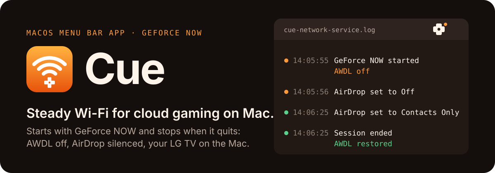
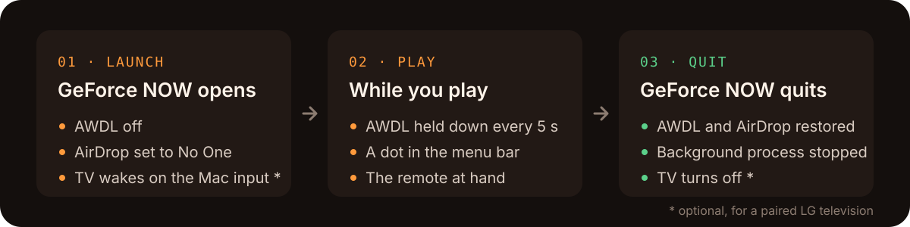
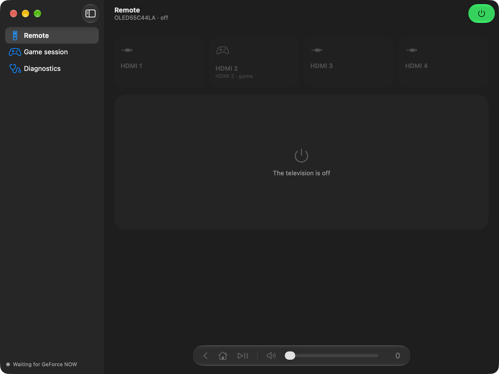
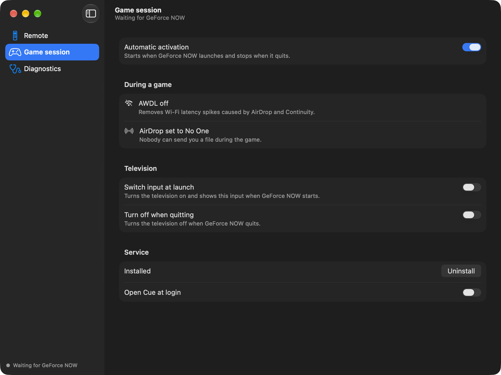

<p align="center">
  
</p>

<p align="center">
  
  
  
  
  
</p>

<p align="center">
  <a href="../../releases/latest"><strong>Download Cue.dmg</strong></a> ·
  <a href="#install">Install</a> ·
  <a href="#television">Television</a> ·
  <a href="#how-it-works">How it works</a> ·
  <a href="#build-from-source">Build</a>
</p>

Cloud gaming over Wi-Fi stutters on a Mac because of AWDL, the Apple Wireless Direct Link interface behind AirDrop and Continuity: it regularly hops to other Wi-Fi channels, and each hop shows up as a latency spike in the stream. Cue switches it off for exactly as long as GeForce NOW runs, with nothing to remember before or after a game.

## What happens during a game

<p align="center">
  
</p>

macOS brings AWDL back up on its own, which is why Cue holds it down every 5 seconds rather than once. Closing the GeForce NOW window leaves a background process running; Cue stops it, so quitting the game really quits it. Each television action is a separate switch, so you can keep watching another input while you play on the Mac.

| Remote | Game session |
| --- | --- |
|  |  |

The interface follows the system language: English or French.

## Install

You need macOS 26 or later and GeForce NOW for Mac. An LG webOS television from 2018 or later is optional.

1. Download `Cue.dmg` from the [latest release](../../releases/latest), open it and drag Cue to Applications. It is signed with a Developer ID and notarized by Apple, so it opens like any downloaded app.
2. In Cue, open **Game session** and click **Install**.
3. macOS opens System Settings > General > Login Items & Extensions: turn Cue on under "Allow in the Background" and confirm with Touch ID or your password.

That is the only time macOS asks: the network service runs as root, because turning AWDL off requires it.

## Television

1. In **Remote**, choose your LG television and click **Pair**, then accept the request shown on the television.
2. In **Game session**, turn on "Switch input at launch" and pick the input your Mac uses, and "Turn off when quitting" if you want it.
3. To let Cue wake the television from standby, enable "Turn on via Wi-Fi" in the television's settings (General > Devices > TV).

The remote covers the inputs, a touchpad for navigation, playback and volume. The Mac keyboard works too: arrows, Return for OK, Escape for back, Space for play/pause, + and − for volume.

## How it works

Cue has two parts.

- **The network service** (`CueNetworkService/main.swift`) is a launchd daemon that runs as root from inside the app bundle. Every 5 seconds it checks whether GeForce NOW is running, and while it is, keeps `awdl0` down. It saves your AirDrop setting in `/var/db/cue-network-service.state` and restores it when the session ends or the service stops. It logs to `/var/log/cue-network-service.log`.
- **The app** registers and removes the service through `SMAppService`, pauses it through `/Users/Shared/cue-network-service.disabled`, and talks to the television through the webOS SSAP API on port 3001 of the local network. When Cue is updated, it reloads the service on its next launch.

The menu bar shows the state: a controller cross while waiting for GeForce NOW, the cross with a dot during a game, a dimmed cross when the service is paused or not installed.

## Uninstall

In Cue, open **Game session** and click **Uninstall**, then quit Cue from the menu bar and delete the app. Uninstalling during a game restores AWDL and AirDrop first.

## Build from source

Open `Cue.xcodeproj` in Xcode 27 or later and run the Cue scheme (⌘R) or its tests (⌘U). From the command line:

```sh
xcodebuild test -project Cue.xcodeproj -scheme Cue -destination 'platform=macOS'
scripts/install_locally.sh   # Release build, signed for development, installed in ~/Applications
```

The tests compile `Shared/` directly and never launch the app, so running them does not touch the installed service. Signing uses the team set in the project: change `DEVELOPMENT_TEAM` to yours, since the network service only runs from an app signed by a team.

<details>
<summary>Project layout</summary>

The project uses synchronized folders: a file added to a folder joins its targets without editing the project.

| Folder | Target | Contents |
| --- | --- | --- |
| `Cue/` | Cue | The menu bar app: `App/` entry point and window, `Views/`, `Models/`, `Television/` client, and `Resources/` (the Icon Composer app icon, the String Catalogs, the LG pairing manifest, the launchd definition that SMAppService registers) |
| `CueNetworkService/` | CueNetworkService | The root network service, embedded in the app |
| `Shared/` | all three | Logic free of interface and side effects: the SSAP messages, Wake-on-LAN, the session state, the touchpad gestures |
| `CueTests/` | CueTests | Swift Testing suites for `Shared/` and the French translation |
| `scripts/` | | Local install, release, and the disk image background |
| `docs/` | | README visuals, screenshots and the design decisions |

</details>

<details>
<summary>Publishing a release</summary>

Store notarization credentials once, then run the release script. It runs the tests, archives, exports with Developer ID, and notarizes and staples `Cue.dmg`:

```sh
xcrun notarytool store-credentials cue-notary --key AuthKey_XXXXXXXXXX.p8 --key-id XXXXXXXXXX --issuer <issuer UUID>
NOTARY_PROFILE=cue-notary scripts/release.sh
```

</details>

## Credits and license

The webOS pairing manifest in `Cue/Resources/lg_registration.json` comes from [aiopylgtv](https://github.com/bendavid/aiopylgtv), MIT license.

Cue is released under the MIT license. See [LICENSE](LICENSE).
